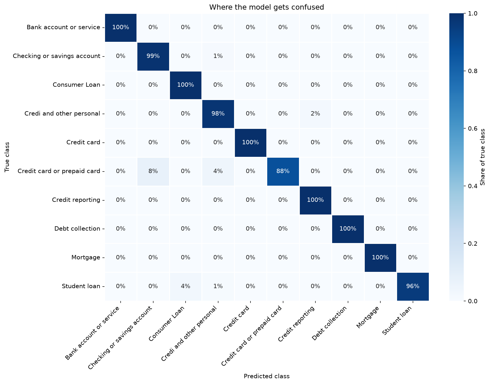

# 📬 Complaint Triage

**Can a model read a raw customer complaint and route it to the right department?**

This project uses a public consumer complaints dataset (real-world text complaints tagged with a product/department category — e.g. credit card, mortgage, student loan, debt collection) to build a multi-class text classifier that predicts which department should handle a new, unseen complaint. The end product is a working `route_complaint(text)` function you can test with complaints you write yourself.

---



*Confusion matrix for the final calibrated LinearSVC model on the 10,000-complaint test set. Each row sums to 100%, so the diagonal is per-category recall.*

## 🎯 Project Questions

- Does TF-IDF beat plain CountVectorizer for this classification task, and by how much?
- Which classifier performs best on high-dimensional sparse text — Naive Bayes, Logistic Regression, or LinearSVC?
- Which complaint categories get confused for which, and why (shared vocabulary)?
- Can the final model correctly route a brand-new complaint you write yourself?

## Findings

**Setup:** 10 product categories, a balanced sample of 50,000 complaints (5,000 per category), stratified 80/20 split (40,000 train / 10,000 test). The input text is the complaint's `Issue` field, vectorized with `TfidfVectorizer(stop_words='english')`, fitted on the training set only.

| Model | Accuracy | Macro-F1 | ROC-AUC | Train time |
|---|---|---|---|---|
| MultinomialNB | 0.9060 | 0.9028 | 0.9967 | 0.13 s |
| LogisticRegression | 0.9792 | 0.9790 | 0.9989 | 0.69 s |
| LinearSVC | 0.9796 | 0.9794 | 0.9988 | 8.32 s |

*Benchmark run with the plain (uncalibrated) models. The shipped model wraps LinearSVC in `CalibratedClassifierCV` (see finding 5), so its training time is roughly 3 times longer.*

1. **LinearSVC and Logistic Regression are a tie:** accuracy differs by 0.0004 and ROC-AUC by 0.0001, which is well inside the noise of a single test split. Logistic Regression trains about 12 times faster, so it is the practical choice if training time matters. LinearSVC was kept as the final model, wrapped in `CalibratedClassifierCV` so it outputs real probabilities.
2. **Naive Bayes trails by about 7 points:** 0.906 accuracy against about 0.979 for the other two. It is the fastest model by far (0.13 s), but its independence assumption costs it on overlapping vocabulary.
3. **The weak spot is "Credit card or prepaid card":** it has the lowest recall (0.875). About 7.8% of its complaints are predicted as "Checking or savings account" and 4.5% as "Credi and other personal". Student loan complaints leak into Consumer Loan (3.5% of them). These are neighbouring categories that share words such as account, card, payment and loan.
4. **How vectorization changes the features** (toy example on 5 short account-related complaints):

   | Vectorizer | Vocabulary size | What changes |
   |---|---|---|
   | `CountVectorizer()` | 12 terms | Raw word counts, so filler words like "and" and "or" get the same weight as content words |
   | `TfidfVectorizer()` | 12 terms | Counts are re-weighted by how rare a word is, and each row is scaled to unit length |
   | `TfidfVectorizer(stop_words='english')` | 10 terms | "and" and "or" disappear, and the weight spreads over the meaningful words |
   | `TfidfVectorizer(stop_words='english', ngram_range=(1, 2))` | 17 terms | Adds two-word phrases such as "debit atm" and "deposits withdrawals" |

   This shows what each option does to the features. It is not a full-dataset head-to-head, so the first Project Question (how much TF-IDF beats plain counts) is not answered with a measured number here.
5. **Calibrated confidence, with a catch:** `LinearSVC` has no `predict_proba`, so the final model is wrapped in `CalibratedClassifierCV`, which turns its scores into real probabilities. With the earlier softmax shortcut, confidence on correct answers sat at a flat 18–57%. With calibration it ranges from about 50% to 99%.
6. **Live test, 11 hand-written complaints:** 7 landed in the category I expected, 1 was arguable (a credit repair complaint routed to *Credit reporting*), and 3 differed from my expectation. Two of those 3 came back with very high confidence: "Overdraft fees charged unexpectedly" (95.8%) and "Problem making deposits and withdrawals" (92.1%), both routed to *Credit card or prepaid card*. The third, "Problem with payments on my personal loan" (52.9%), also went to *Credit card or prepaid card*. My expected categories are my own guesses, not taken from the dataset, so some of these may be the model correctly following how that wording is filed in the data. Either way, the lesson is the same: calibrated confidence is honest on text that looks like the training data, but it is not a safety net on unfamiliar wording, so a "needs human review" cutoff alone would not have caught these.
7. **Read the near-perfect scores with care:** ROC-AUC of 0.999 and 98% accuracy are high because the `Issue` field holds only a few dozen distinct values, so the same strings appear in both train and test. The model is mostly learning which issue strings belong to which product, and that is an easier task than understanding free-form complaint text. Scores on genuinely new wording, like the live test above, are lower and less confident.

---

## 📁 Repository Structure

```
complaint-triage/
├── data/
│   ├── raw/                  # Untouched source complaints dataset
│   └── processed/            # Cleaned text + train/test split (TF-IDF matrices as .npz, labels as .csv)
│
├── notebooks/                 # Step-by-step, one notebook per phase
│   ├── 01_load_explore.ipynb
│   ├── 02_vectorization_countvec_tfidf.ipynb
│   ├── 03_train_test_split.ipynb
│   ├── 04_classifiers_naive_bayes_logreg_svm.ipynb
│   └── 05_evaluation_confusion_matrix.ipynb
│
├── src/                        # Reusable code, imported by notebooks/scripts (not copy-pasted)
│   ├── __init__.py
│   ├── data_load.py           # Load raw complaints dataset
│   ├── preprocess.py           # Text cleaning, split, vectorizer fit/transform helpers
│   ├── train.py                 # Trains the calibrated LinearSVC and saves it
│   ├── evaluate.py              # classification_report, confusion matrix, ROC-AUC, heatmap
│   └── route.py                  # route_complaint(text) — the final usable function
│
├── tests/                      # Unit tests for src/ functions
│   ├── __init__.py
│   └── test_preprocess.py
│
├── models/                     # Saved trained vectorizer + classifier (.joblib), gitignored
│
├── outputs/
│   └── figures/                  # Confusion matrix heatmap, vectorizer comparison plots
│
├── .gitignore
├── requirements.txt
└── README.md
```

---

## 🛠️ Setup

```bash
git clone https://github.com/hexsyro/complaint-triage
cd complaint-triage
python -m venv venv
source venv/bin/activate       # Windows: venv\Scripts\activate
pip install -r requirements.txt
```

---

## 🚀 Usage

Run every command from the project root, because the scripts use relative paths such as `data/processed/` and `models/`.

1. **Load raw complaints dataset** (fills `data/raw/`)
   ```bash
   python -m src.data_load
   ```
2. **Preprocess: clean text, split, vectorize** (fills `data/processed/`)
   ```bash
   python -m src.preprocess
   ```
3. **Train and evaluate the classifier** (saves `models/LinearSVC_model.joblib` and prints the evaluation report)
   ```bash
   python -m src.train
   python -m src.evaluate
   ```
4. **Explore in notebooks**, in order, starting with `notebooks/01_load_explore.ipynb`
5. **Try the final router** once a model is trained and saved (the `models/` folder is gitignored, so run step 3 first). Type a complaint and press Enter, or type `q` to quit:
   ```bash
   python -m src.route
   ```

   Example session:
   ```
   write a complaint to predict the product: Incorrect information on your credit report

   === Here is the Prediction report ===

   the product is likely a: Credit reporting
   the confidence of the prediction is: 99.09%
   ```

   More complaints to try:
   ```
   "My credit card company charged me twice for the same purchase"
   "Unexpected late fee charged on my account"
   "Collector keeps calling about a debt I do not owe"
   "Incorrect information on my credit report"
   "Problem with escrow payment on my home loan"
   "Unauthorized transaction on my prepaid card"
   ```

---

## 📊 Skills Practiced

| Skill | Where |
|---|---|
| Text vectorization (CountVectorizer, TF-IDF) | `notebooks/02`, `src/preprocess.py` |
| Train/test split workflow (with stratify, correct fit/transform order) | `notebooks/03`, `src/preprocess.py` |
| Applying classifiers to text data (Naive Bayes, Logistic Regression, LinearSVC) | `notebooks/04`, `src/train.py` |
| Evaluating classification performance (macro/weighted F1, confusion matrix) | `notebooks/05`, `src/evaluate.py` |

---

## 📈 Sample Finding

> LinearSVC and Logistic Regression tied at about 0.979 macro-F1, while Naive Bayes trailed at 0.903. The weakest category was "Credit card or prepaid card" (recall 0.875), mostly mistaken for "Checking or savings account" — the two share a lot of account and card vocabulary.

---

## 📄 Data Sources

- Complaints dataset: [Consumer Complaints](https://www.kaggle.com/datasets/heemalichaudhari/consumer-complaints)

---

## 🔭 Possible Extensions

- Add a "confidence threshold" to route_complaint() — if the top prediction's probability is
  too low, return "needs human review" instead of forcing a guess (probabilities are already calibrated, but test the cutoff on fresh wording, since some wrong answers still score above 90%)
- Train on the free-text `Consumer Complaint` narrative instead of the short `Issue` field, for a harder and more realistic test
- Run a full CountVectorizer vs TF-IDF vs bigram comparison and report macro-F1 for each
- Try word embeddings (e.g. average word2vec vectors) instead of TF-IDF and compare
- Build a tiny CLI or Streamlit app around route_complaint() for live testing